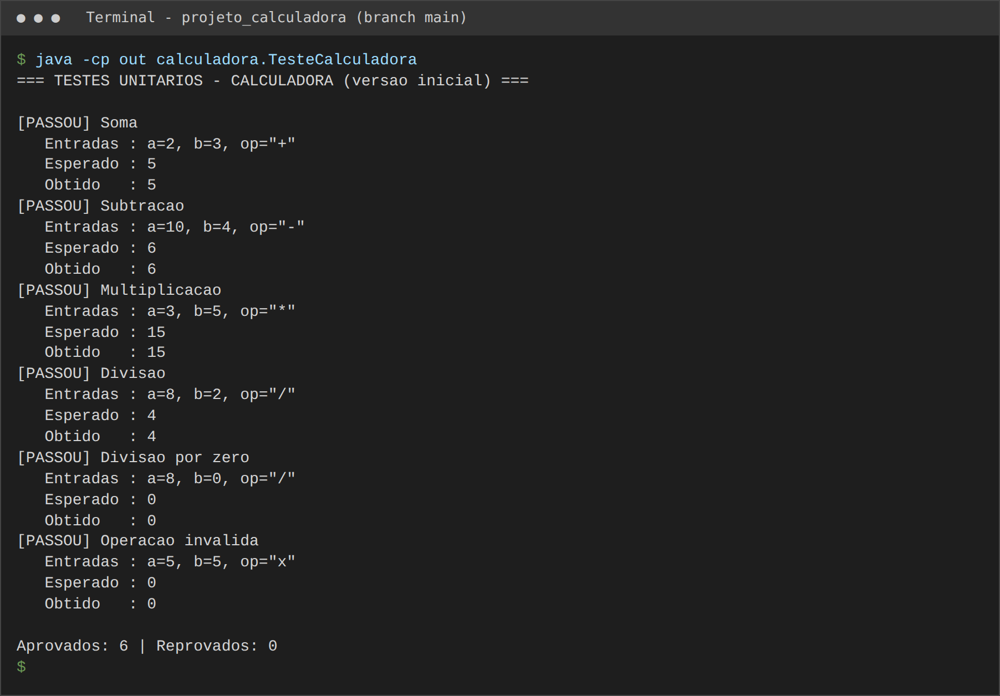
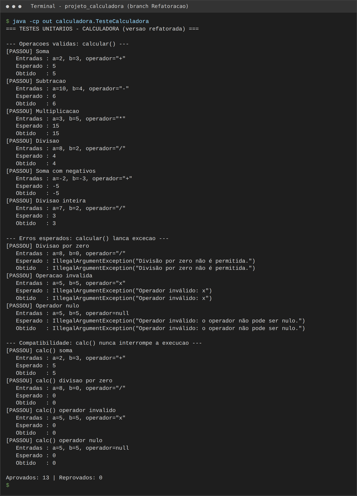
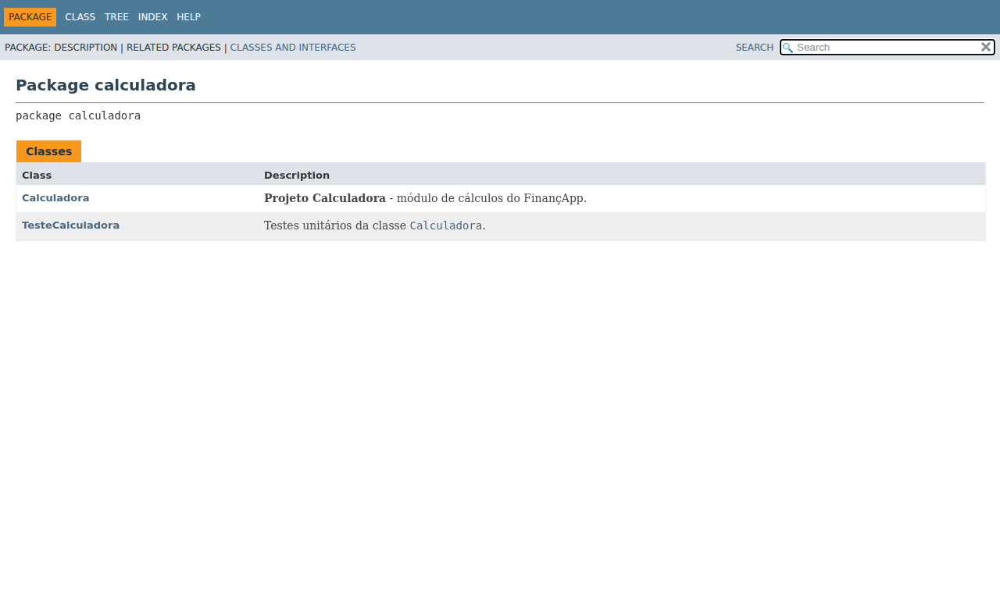
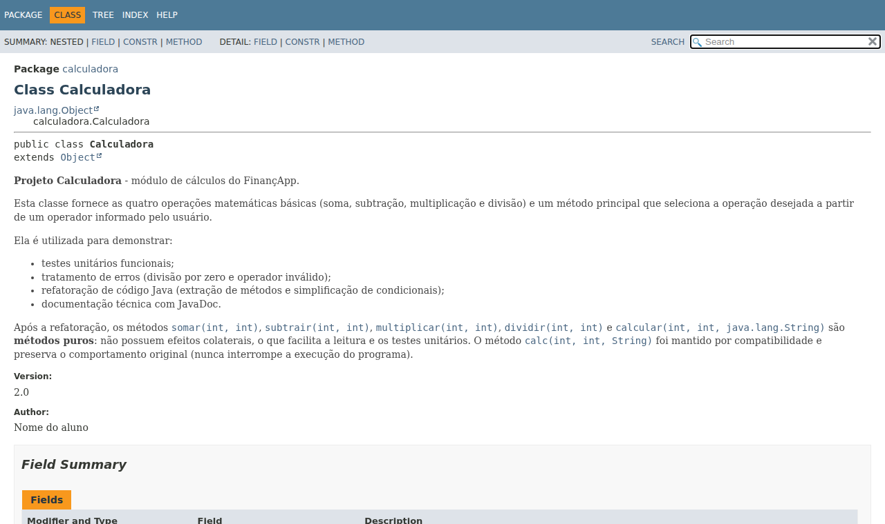
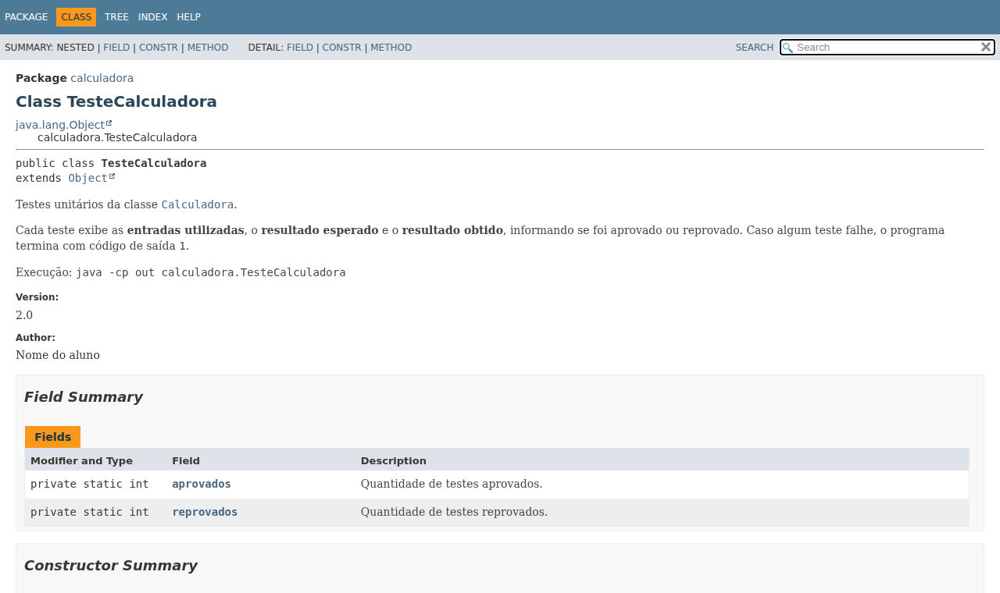

# Projeto Calculadora — FinançApp

---

## 1. Identificação do Projeto

| Campo | Informação |
|---|---|
| **Projeto** | Projeto Calculadora |
| **Contexto** | FinançApp (startup fictícia — aplicativo mobile de finanças pessoais) |
| **Aluno** | Mario Hildebrando Padovani Neto |
| **RA** | 251151 |
| **Curso** | Cursos Tecnológicos — Turma AS406TSN1 |
| **Disciplina** | UX/UI e Testes de Software |
| **Professor** | Daniel Ohata |
| **Instituição** | UniFacens |
| **Semestre** | 2026.2 |

---

## 2. Visão Geral

O projeto consiste no desenvolvimento de um módulo de cálculos matemáticos básicos em Java para a startup fictícia **FinançApp**.

O módulo foi desenvolvido com o objetivo de ser utilizado futuramente em funcionalidades de controle financeiro, como:

- orçamento mensal;
- divisão de despesas;
- projeções financeiras;
- cálculos auxiliares.

Além do funcionamento correto das operações, o projeto aplica práticas de qualidade de software relacionadas a:

- testes;
- tratamento de erros;
- refatoração;
- documentação;
- versionamento;
- manutenção de código.

---

## 3. Problema

Durante o desenvolvimento da aplicação FinançApp, foi identificada a necessidade de criar um **módulo matemático reutilizável**.

Entretanto, a equipe definiu que o módulo não deveria apenas funcionar corretamente, mas também apresentar:

- código legível;
- testes automatizados;
- tratamento de falhas;
- documentação técnica;
- controle de versões;
- facilidade de manutenção.

O desafio consiste, portanto, em desenvolver uma solução funcional e, ao mesmo tempo, aplicar boas práticas de Engenharia de Software.

---

## 4. Objetivo

### 4.1 Objetivo Geral

Desenvolver uma calculadora em Java aplicando práticas de qualidade, testes, documentação, refatoração e versionamento.

### 4.2 Objetivos Técnicos

- implementar operações matemáticas básicas;
- tratar entradas inválidas;
- impedir divisão por zero;
- desenvolver testes automatizados;
- refatorar o código sem alterar seu comportamento;
- documentar classes e métodos com JavaDoc;
- gerar documentação HTML;
- utilizar Git e GitHub;
- organizar commits e branches;
- manter documentação técnica no README.

---

## 5. Escopo Funcional

A aplicação oferece as seguintes operações:

| ID | Funcionalidade | Descrição | Status |
|---|---|---|---|
| RF01 | Soma | Soma dois números inteiros | ✅ |
| RF02 | Subtração | Subtrai dois números inteiros | ✅ |
| RF03 | Multiplicação | Multiplica dois números inteiros | ✅ |
| RF04 | Divisão | Divide dois números inteiros | ✅ |
| RF05 | Validação de divisão | Impede divisão por zero | ✅ |
| RF06 | Operação inválida | Trata operadores não suportados | ✅ |

---

## 6. Requisitos Não Funcionais

| ID | Categoria | Requisito | Como foi atendido |
|---|---|---|---|
| RNF01 | Qualidade | O código deve possuir organização e legibilidade | Métodos pequenos, nomes descritivos, `switch` no lugar de `if/else` encadeado |
| RNF02 | Testabilidade | As operações devem possuir testes automatizados | Classe `TesteCalculadora` (13 testes) |
| RNF03 | Manutenção | O código deve permitir refatoração sem alteração funcional | Testes executados antes e depois da refatoração |
| RNF04 | Documentação | Classes e métodos devem possuir JavaDoc | 100% documentado, gerado sem avisos (`-Xdoclint:all`) |
| RNF05 | Versionamento | O projeto deve utilizar Git e GitHub | Branches `main` e `Refatoracao`, commits semânticos |
| RNF06 | Confiabilidade | Erros não devem interromper inesperadamente a execução | `calc()` captura as falhas e retorna `0` com mensagem |

---

## 7. Tecnologias Utilizadas

| Tecnologia | Versão | Utilização |
|---|---|---|
| Java | 21 | Desenvolvimento |
| JDK (OpenJDK) | 21 | Compilação e geração do JavaDoc |
| Testes em Java puro | — | Classe `TesteCalculadora` com relatório *entradas / esperado / obtido* (sem dependências externas) |
| Git | 2.43 | Controle de versão |
| GitHub | — | Repositório remoto |
| JavaDoc | 21 | Documentação técnica (HTML) |
| IDE | VS Code ou Eclipse | Ambiente de desenvolvimento |

---

## 8. Estrutura do Projeto

```
projeto_calculadora/
│
├── src/
│   └── calculadora/
│       └── Calculadora.java
│
├── test/
│   └── calculadora/
│       └── TesteCalculadora.java
│
├── docs/
│   └── index.html            ← documentação JavaDoc gerada
│
├── images/
│   ├── testes/               ← prints da versão inicial
│   ├── javadoc/              ← prints da documentação
│   └── refatoracao/          ← prints dos testes após a refatoração
│
├── README.md
└── .gitignore
```

---

## 9. Print da Execução dos Testes

Compilação e execução (a partir da raiz do projeto, com JDK 17 ou superior):


### 9.1 Antes da refatoração (6 testes)

Cada teste exibe as **entradas utilizadas**, o **resultado esperado** e o **resultado obtido**.



### 9.2 Após a refatoração (13 testes)



**Taxa de sucesso:** (13 aprovados / 13 executados) × 100 = **100%**

---

## 10. Print da Documentação JavaDoc

Documentação gerada com o comando abaixo; o arquivo [`docs/index.html`](docs/index.html) abre normalmente no navegador.

**Página inicial (pacote `calculadora`)**



**Classe `Calculadora`**



**Classe `TesteCalculadora`**



---

## 11. Link do Repositório

🔗 **https://github.com/MarioPadovani-dev/projeto_calculadora**
